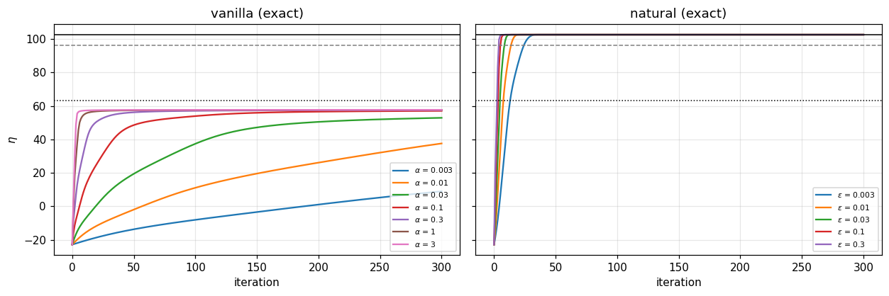
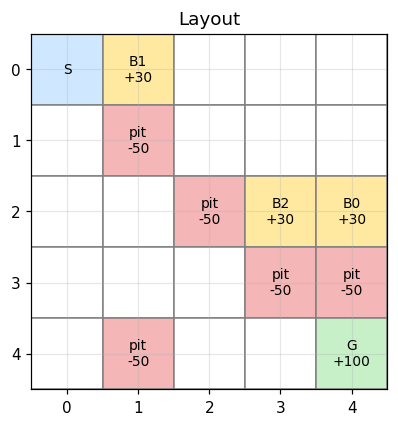
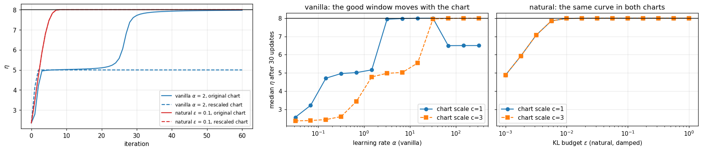

# The Natural Policy Gradient through Differential Geometry

**Theory, algorithm and experiments** — Emil Hausel-Vargha, course project on differential geometry (NTU, 2026).

📄 **[Read the report (PDF)](paper/natural_gradient_paper.pdf)**

Plain policy-gradient ascent is not chart invariant: the gradient $\nabla_\theta\eta$ of the expected return is a covector, the update $\Delta\theta$ is a vector, and equating the two only works in one parametrization. Rescaling a coordinate by $c$ changes the effective step by $1/c^2$, and changing the reference action of a softmax changes the trajectory.

This project treats the set of policies as a manifold $\mathcal M$, parametrizations as charts, and uses the **Fisher metric** — the Hessian of the KL divergence at its minimum — to turn the differential of the return into an ascent direction. Following Kakade's *A Natural Policy Gradient* (2001), it

- builds a genuine chart of tabular policies (reference-action logits) and shows why the redundant softmax gives a singular Fisher matrix;
- derives the natural gradient in closed form, $w_{s,a} = A^\pi(s,a) - A^\pi(s,a_{\mathrm{ref}})$, i.e. the exponentiated-advantage update, with step size set by a KL budget $\varepsilon$;
- proves Kakade's theorem (natural gradient = least-squares fit of the advantage on the score);
- shows that a global ridge on $F$ reintroduces the visitation weights, and uses a **statewise** regularisation instead;
- tests everything on a Gaussian bandit and a gridworld with bonuses and pits.

<p align="center">
  
</p>
<p align="center"><sub><b>Gridworld, noise-free updates.</b> The expected discounted return η of plain gradient ascent (left) plateaus near 57 for every learning rate, without collecting the bonuses. The natural gradient (right) reaches the optimum η* = 102.55 for every KL budget ε, within about 30 iterations even for the smallest.</sub></p>


## Main results



The gridworld is a 5×5 grid with a start S, a terminal goal G worth +100, bonus squares worth +30 the first time they are entered in an episode, terminal pits worth −50 and a cost of −1 per move. Reaching the optimum $\eta^*$ requires collecting the bonuses on the way to the goal.

<br clear="right">

| | Bandit (3 arms) | Gridworld (5×5, 246-dim policy manifold) |
|---|---|---|
| Exact natural gradient | reaches $\eta^*$ for every $\varepsilon$ | reaches $\eta^*=102.55$ for every $\varepsilon$ |
| Exact plain gradient | plateaus on the middle arm at small $\alpha$ | stalls at ~64% of the gap, never collects the bonuses |
| Sampled natural (damped) | 40/40 runs solved for every $\varepsilon$ | 7–8/10 runs solved ($\varepsilon \ge 0.03$); failures are an exploration issue |
| Sampled plain | 29–39/40 solved, depends on $\alpha$ | 0/10 solved |
| Rescaled chart | natural: identical to $10^{-15}$; plain: differs by up to 2.97 in $\eta$ | natural: identical to $10^{-12}$; plain: differs by 11.1 |

<p align="center">
  
</p>
<p align="center"><sub><b>Changing the chart on the bandit.</b> Rescaling the coordinates by c = 3 (dashed) traps plain gradient ascent on the middle arm and shifts its window of good learning rates, while the natural gradient follows the same curve in both charts.</sub></p>

The natural gradient's advantage is invariance, a step size with an intrinsic meaning and robustness to its hyperparameter — not raw speed in every chart: with a favourable reference arm, tuned plain gradient can be faster on the bandit.

## Repository layout

```
paper/
  natural_gradient_paper.tex   # the report (LaTeX source)
  natural_gradient_paper.pdf   # compiled report
  figures/                     # figures used by the report (extracted from the notebooks)
docs/                          # README images (extracted from the notebooks)
notebooks/
  natural_gradient_bandit.ipynb      # Gaussian bandit experiments
  natural_gradient_gridworld.ipynb   # gridworld experiments
scripts/
  extract_figures.py           # pulls the notebook plots into paper/figures/ and docs/
```

## Running

```bash
pip install -r requirements.txt
jupyter lab notebooks/
```

Every setting (arms, layout, rewards, discount, batch size, hyperparameter grids, damping, cap, seeds) is a variable in the configuration cell at the top of each notebook; edit and *Run All*. The notebooks are committed with their outputs, so the plots are visible on GitHub without running anything.

To rebuild the report after re-running the notebooks:

```bash
python scripts/extract_figures.py
cd paper && latexmk -pdf natural_gradient_paper.tex
```

## License

The code is released under the [MIT License](LICENSE). If you use this work, see [`CITATION.cff`](CITATION.cff).

## Reference

S. Kakade, *A Natural Policy Gradient*, NeurIPS 14, 2001.
